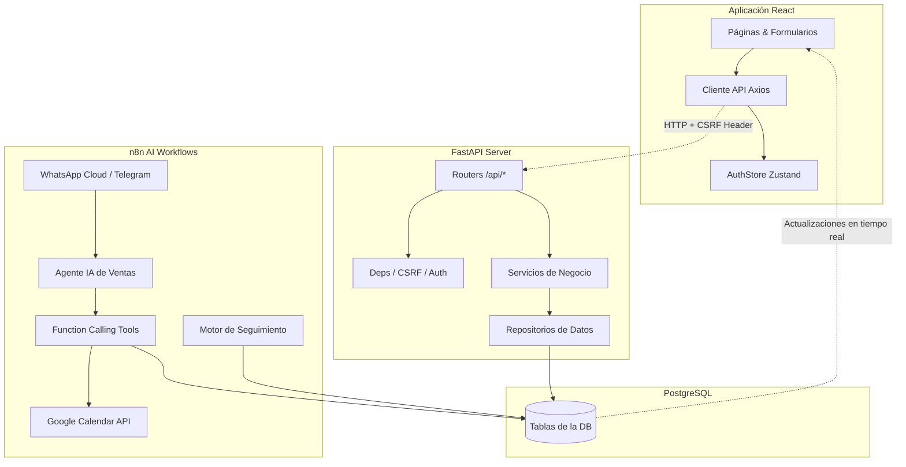

# 🗺️ Mapa de Funcionalidades y Estructura — AutoGestor CRM

Este documento divide el proyecto en **8 módulos funcionales**. Cada sección agrupa los archivos correspondientes en el Frontend (React + TypeScript), el Backend (FastAPI + SQLModel), la Base de Datos (PostgreSQL) y las Integraciones (n8n + WhatsApp + Google Calendar). 

También incluye una sección de **Puntos Críticos de Falla (Edge Cases)** para cada funcionalidad, preparándonos para analizarlas al detalle individualmente.

---

## 📁 Resumen General del Proyecto
- **Frontend:** React + Tailwind CSS + Vite + TypeScript (en `frontend/`)
- **Backend:** FastAPI + SQLModel (en `backend/`)
- **Base de Datos:** PostgreSQL (compartida con n8n, esquema en `db_init.sql`)
- **Orquestación de IA y Canales:** n8n (flujos en `workflows/`) + WhatsApp Cloud API + Google Calendar.

---

---

## 1. 🔑 Autenticación, Usuarios y Seguridad
Gestión del registro de administrador, inicio de sesión, restauración de contraseñas y middleware de seguridad para evitar solicitudes no autorizadas (CSRF y tokens de sesión caducados).

*   **Frontend:**
    *   **Páginas:**
        *   [LoginPage.tsx](file:///home/cristian/trabajo/vendedor-ia-n8n/frontend/src/pages/LoginPage.tsx) - Formulario de ingreso.
        *   [ForgotPasswordPage.tsx](file:///home/cristian/trabajo/vendedor-ia-n8n/frontend/src/pages/ForgotPasswordPage.tsx) - Solicitud de restablecimiento.
        *   [ResetPasswordPage.tsx](file:///home/cristian/trabajo/vendedor-ia-n8n/frontend/src/pages/ResetPasswordPage.tsx) - Nueva clave mediante token.
    *   **Componentes de Ruta:**
        *   [ProtectedRoute.tsx](file:///home/cristian/trabajo/vendedor-ia-n8n/frontend/src/components/ProtectedRoute.tsx) - Restringe acceso a usuarios no logueados.
    *   **Estado:**
        *   [authStore.ts](file:///home/cristian/trabajo/vendedor-ia-n8n/frontend/src/store/authStore.ts) - Estado global del usuario usando Zustand.
    *   **Cliente API:**
        *   [client.ts](file:///home/cristian/trabajo/vendedor-ia-n8n/frontend/src/api/client.ts) - Configuración de Axios, inyección de tokens y refresco automático.
*   **Backend:**
    *   **Módulo de Usuarios:** `backend/app/Modules/usuarios/`
        *   `router.py` - Rutas de `/api/auth/login`, `/refresh`, `/forgot-password`, `/reset-password`.
        *   `model.py` - Modelos de SQLModel para `Usuario`, `RefreshToken`, y `PasswordResetToken`.
        *   `service.py` - Lógica de generación de tokens, verificación y lógica de negocio de contraseñas.
        *   `repository.py` - Interacción con la DB para consultas/inserciones de usuarios y tokens.
        *   `schema.py` - Esquemas Pydantic para peticiones y respuestas.
    *   **Seguridad Core:** `backend/app/Core/Security/`
        *   `deps.py` - Dependencias de FastAPI como `get_current_user` y `require_admin`.
        *   `jwt.py` - Creación y decodificación de tokens de acceso y refresco.
    *   **Global Middlewares:**
        *   [main.py:L43-58](file:///home/cristian/trabajo/vendedor-ia-n8n/backend/main.py#L43-L58) - Filtro CSRF personalizado que exige el header `x-vendedoria-crm-vehiculos` para peticiones mutables (`POST`, `PUT`, `DELETE`).
*   **Base de Datos (`db_init.sql`):**
    *   Tablas creadas dinámicamente por SQLModel en `startup`: `usuarios`, `refresh_tokens`, y `password_reset_tokens`.
*   **⚠️ Puntos Críticos de Falla a Analizar:**
    *   *Caducidad de Tokens:* ¿Qué ocurre en el frontend si el Refresh Token expira a mitad de una transacción larga?
    *   *Seguridad CSRF:* Si n8n necesita realizar un POST a la base de datos o al backend, ¿le afectará el middleware CSRF?
    *   *Fallas en envío de correos:* ¿Qué pasa si el sistema de "Olvidé mi contraseña" falla al enviar el correo debido a límites de API?

---

## 2. 🚗 Vehículos e Inventario (Stock)
Catálogo físico de autos en venta, detalles técnicos, y carga/edición de múltiples imágenes.

*   **Frontend:**
    *   **Páginas:**
        *   [VehiculosPage.tsx](file:///home/cristian/trabajo/vendedor-ia-n8n/frontend/src/pages/VehiculosPage.tsx) - Tarjetas horizontales de vehículos.
        *   [VehiculoDetailPage.tsx](file:///home/cristian/trabajo/vendedor-ia-n8n/frontend/src/pages/VehiculoDetailPage.tsx) - Ficha completa del auto con galería.
    *   **Formularios:**
        *   [VehiculoForm.tsx](file:///home/cristian/trabajo/vendedor-ia-n8n/frontend/src/components/forms/VehiculoForm.tsx) - Carga y edición de datos (modelo, precio, kms, patente, etc.) y carga de archivos de imagen.
    *   **Cliente API:**
        *   [vehiculos.ts](file:///home/cristian/trabajo/vendedor-ia-n8n/frontend/src/api/vehiculos.ts) - Consumo de endpoints CRUD.
*   **Backend:**
    *   **Módulo Vehículos:** `backend/app/Modules/vehiculos/` (router, model, service, repository, schema).
    *   **Módulo de Gestión de Imágenes:** `backend/app/Modules/imagenes/` - Servidor estático y procesamiento de subidas físicas de archivos.
*   **Base de Datos (`db_init.sql`):**
    *   Tabla `vehiculos` - Campos como `patente` (UNIQUE), `precio`, `kilometraje`, `estado` (check constraints: `disponible`, `vendido`, `reservado`).
    *   Tabla `vehiculo_imagenes` - Rutas de archivos y bandera `es_principal`. Relación `ON DELETE CASCADE`.
*   **Integración con IA (n8n):**
    *   La herramienta `buscar_vehiculos` del bot lee directamente la tabla `vehiculos` filtrando por filtros de texto que dice el usuario (marca, modelo, precio máximo).
*   **⚠️ Puntos Críticos de Falla a Analizar:**
    *   *Formatos e Inyecciones en Carga de Imágenes:* ¿Hay validación de tipo de archivo (mime-type) y tamaño máximo de imagen en el backend antes de guardarlo en disco?
    *   *Patentes Duplicadas:* ¿Cómo reacciona el backend/frontend cuando se intenta registrar un auto con una patente que ya existe en la DB? (Lanza error 500 o responde un 400 amigable).
    *   *Eliminación de archivos físicos:* Cuando se borra un vehículo, ¿se borran físicamente sus imágenes del directorio `fotos/` en la VPS, o quedan acumulándose indefinidamente?

---

## 3. 👥 Clientes (CRM)
Directorio de personas interesadas o compradores históricos.

*   **Frontend:**
    *   **Páginas:**
        *   [ClientesPage.tsx](file:///home/cristian/trabajo/vendedor-ia-n8n/frontend/src/pages/ClientesPage.tsx) - Tabla de clientes y volumen de compras.
    *   **Formularios:**
        *   [ClienteForm.tsx](file:///home/cristian/trabajo/vendedor-ia-n8n/frontend/src/components/forms/ClienteForm.tsx) - Creación/edición manual de clientes.
    *   **Cliente API:**
        *   [clientes.ts](file:///home/cristian/trabajo/vendedor-ia-n8n/frontend/src/api/clientes.ts).
*   **Backend:**
    *   **Módulo Clientes:** `backend/app/Modules/clientes/` (router, model, service, repository, schema).
*   **Base de Datos (`db_init.sql`):**
    *   Tabla `clientes` - `telefono` (PRIMARY KEY, clave única), `nombre`, `cantidad_compras`, `estado_conversacion` (control para la IA), `id_mensaje_esperado`.
*   **Integración con IA (n8n):**
    *   Al recibir cualquier mensaje, n8n consulta si el cliente existe. Si no, lo crea de forma automática en la DB utilizando el número de teléfono como ID.
*   **⚠️ Puntos Críticos de Falla a Analizar:**
    *   *Formatos de Teléfono:* WhatsApp envía los números con formato internacional (ej. `549261...`). Si un cliente se carga a mano con formato local (ej. `261...` o con `+`), la IA no podrá mapear la sesión y creará un duplicado.
    *   *Condiciones de Carrera (Race Conditions):* Si un cliente envía tres mensajes seguidos muy rápido y n8n ejecuta en paralelo, ¿se crean múltiples filas o choca la inserción concurrente en Postgres?

---

## 4. 📅 Citas y Calendario
Motor de reserva de turnos (visitas, pruebas de manejo, entrega de vehículos).

*   **Frontend:**
    *   **Páginas:**
        *   [CalendarPage.tsx](file:///home/cristian/trabajo/vendedor-ia-n8n/frontend/src/pages/CalendarPage.tsx) - Calendario interactivo (mensual/semanal/diario).
    *   **Modales/Formularios:**
        *   [CitaModal.tsx](file:///home/cristian/trabajo/vendedor-ia-n8n/frontend/src/components/CitaModal.tsx) - Agendar cita manual, modificar fecha/hora, cambiar estado (`pendiente`, `confirmada`, `cancelada`).
    *   **Cliente API:**
        *   [citas.ts](file:///home/cristian/trabajo/vendedor-ia-n8n/frontend/src/api/citas.ts).
*   **Backend:**
    *   **Módulo Citas:** `backend/app/Modules/citas/` (router, model, service, repository, schema).
*   **Base de Datos (`db_init.sql`):**
    *   Tabla `citas` - Relaciona cliente y vehículo.
    *   **Regla de Negocio Crítica:** `idx_unica_cita_por_dia` (Índice único compuesto que impide que un cliente registre más de una cita por día).
*   **Integración con IA (n8n + Google Calendar):**
    *   El bot usa las herramientas `agendar_cita` y `cancelar_cita` para modificar la DB local y, al mismo tiempo, sincronizar eventos en la cuenta de Google Calendar de la concesionaria.
    *   *Notificación interna:* Al crearse una cita (por n8n o admin), se dispara un mensaje de WhatsApp a todos los empleados activos.
*   **⚠️ Puntos Críticos de Falla a Analizar:**
    *   *Zonas Horarias:* Google Calendar trabaja en UTC o zonas horarias específicas de Google. El servidor FastAPI y Postgres pueden estar en UTC, y el frontend del usuario en hora local (Argentina/Chile, etc.). ¿Los horarios mostrados en el calendario coinciden exactamente con los reservados?
    *   *Desincronización n8n/Calendar:* Si la llamada de n8n a Google Calendar falla (por límite de cuota o token vencido), pero la base de datos Postgres sí se actualizó, la cita queda en un estado inconsistente.
    *   *La regla de "Una cita por día":* ¿El frontend y el bot de n8n manejan con gracia el error de la DB al intentar romper esta restricción, o explotan con un error genérico de base de datos?

---

## 5. 💼 Ventas y Transacciones
Historial inmutable de operaciones cerradas.

*   **Frontend:**
    *   **Páginas:**
        *   [VentasPage.tsx](file:///home/cristian/trabajo/vendedor-ia-n8n/frontend/src/pages/VentasPage.tsx) - Listado histórico de ventas realizadas.
    *   **Formularios:**
        *   [VentaForm.tsx](file:///home/cristian/trabajo/vendedor-ia-n8n/frontend/src/components/forms/VentaForm.tsx) - Registro manual de venta.
    *   **Modales:**
        *   [MarcarVendidoModal.tsx](file:///home/cristian/trabajo/vendedor-ia-n8n/frontend/src/components/modals/MarcarVendidoModal.tsx) - Modal interactivo que se abre desde la tarjeta de vehículo para registrar la venta en un solo paso.
    *   **Cliente API:**
        *   [ventas.ts](file:///home/cristian/trabajo/vendedor-ia-n8n/frontend/src/api/ventas.ts).
*   **Backend:**
    *   **Módulo Ventas:** `backend/app/Modules/ventas/` (router, model, service, repository, schema).
*   **Base de Datos (`db_init.sql`):**
    *   Tabla `ventas` - Guarda el ID de vehículo, teléfono del cliente, precio final, método de pago y notas de la operación.
*   **⚠️ Puntos Críticos de Falla a Analizar:**
    *   *Inmutabilidad:* La regla de negocio indica que las ventas "no son editables ni eliminables". ¿El backend realmente rechaza peticiones `PUT` y `DELETE` en este router, o solo se ocultaron los botones en el frontend?
    *   *Consistencia de Estado:* Al registrar una venta, el estado del vehículo debe cambiar a `vendido`. Si la inserción en la tabla `ventas` tiene éxito, pero la actualización del estado del vehículo en `vehiculos` falla, la DB queda inconsistente. (¿Se usa una transacción SQL/UOW para ambas operaciones?).

---

## 6. 👥 Trabajadores y Notificaciones
Registro de empleados habilitados para atender y recibir notificaciones del sistema.

*   **Frontend:**
    *   **Páginas:**
        *   [TrabajadoresPage.tsx](file:///home/cristian/trabajo/vendedor-ia-n8n/frontend/src/pages/TrabajadoresPage.tsx) - Listado y control de notificaciones activas.
    *   **Formularios:**
        *   [TrabajadorForm.tsx](file:///home/cristian/trabajo/vendedor-ia-n8n/frontend/src/components/forms/TrabajadorForm.tsx) - Carga y edición de datos de empleados.
    *   **Cliente API:**
        *   [trabajadores.ts](file:///home/cristian/trabajo/vendedor-ia-n8n/frontend/src/api/trabajadores.ts).
*   **Backend:**
    *   **Módulo Trabajadores:** `backend/app/Modules/trabajadores/` (router, model, service, repository, schema).
*   **Base de Datos (`db_init.sql`):**
    *   Tabla `trabajadores` - `telefono` (UNIQUE), `rol`, y `recibe_notificaciones` (BOOLEAN).
*   **⚠️ Puntos Críticos de Falla a Analizar:**
    *   *Errores de formato de teléfono en el envío:* Si el teléfono del trabajador no tiene cargado el formato internacional correcto de WhatsApp, la API de n8n fallará al enviar el aviso de nueva cita, arruinando la alerta.
    *   *Fallas en cadena:* Si la API de n8n tarda en responder al disparar la alerta a los trabajadores, ¿el backend de FastAPI se queda bloqueado esperando la respuesta (petición sincrónica lenta) o lo hace en segundo plano (asincrónico)?

---

## 7. 📣 Promociones y Campañas de Difusión
Creación de campañas de marketing activas que el bot puede usar para cross-selling o enviar masivamente.

*   **Frontend:**
    *   **Páginas:**
        *   [PromocionesPage.tsx](file:///home/cristian/trabajo/vendedor-ia-n8n/frontend/src/pages/PromocionesPage.tsx) - Visualización de campañas.
    *   **Formularios:**
        *   [PromocionForm.tsx](file:///home/cristian/trabajo/vendedor-ia-n8n/frontend/src/components/forms/PromocionForm.tsx) - Creador de promociones con fechas límites.
    *   **Cliente API:**
        *   [promociones.ts](file:///home/cristian/trabajo/vendedor-ia-n8n/frontend/src/api/promociones.ts).
*   **Backend:**
    *   **Módulo Promociones:** `backend/app/Modules/promociones/` (router, model, service, repository, schema).
*   **Base de Datos (`db_init.sql`):**
    *   Tabla `promociones` - Campos de fechas de inicio y fin, y check constraint de estado (`activa`, `inactiva`).
*   **⚠️ Puntos Críticos de Falla a Analizar:**
    *   *Validación de Rango de Fechas:* ¿El backend valida que la fecha de fin sea posterior a la fecha de inicio?
    *   *Manejo del Estado Temporal:* Si una promoción pasa su fecha de fin, ¿el sistema cambia automáticamente su estado a `inactiva` en la DB, o se sigue ofreciendo al cliente hasta que un administrador la desactive manualmente?

---

## 8. 🤖 Motor de Mensajería, Seguimiento y Retargeting (n8n + IA)
El cerebro conversacional y de seguimiento automatizado. Es el encargado de enviar los recordatorios programados a clientes y coordinar el bot de IA.

*   **Flujos de Trabajo (n8n en `workflows/`):**
    *   `Agente de Ventas IA.json` - Recibe el webhook del chat (WhatsApp o Telegram), clasifica la intención, llama herramientas para interactuar con la Postgres DB (buscar vehículos, agendar turnos, guardar reseñas) y responde.
    *   `Motor de Seguimiento y Retargeting.json` - Script cron o trigger que evalúa periódicamente mensajes listos para ser enviados.
*   **Base de Datos (`db_init.sql`):**
    *   Tabla `mensajes_programados` - Mantiene la lista de envíos pendientes (`RECORDATORIO_PAGO`, `CALIDAD_RESEÑA`, `CROSS_SELLING`, `SALUDO_FESTIVO`) con fechas programadas y estados (`PENDIENTE`, `ENVIADO`, `RESPONDIDO`, `CANCELADO`).
*   **⚠️ Puntos Críticos de Falla a Analizar:**
    *   *Sistema Anti-Spam:* ¿Qué pasa si el cron se ejecuta dos veces por error? ¿Se enviaría el mismo mensaje dos veces al cliente?
    *   *Sobrescritura de Sesión de Chat:* ¿La memoria de la conversación está limitada por tokens para evitar que el bot de WhatsApp empiece a responder de forma errática o consuma demasiados dólares en llamadas a la API de Anthropic/OpenAI?
    *   *Manejo del estado 'RESPONDIDO':* Si programamos un recordatorio de pago, y el usuario nos habla espontáneamente por WhatsApp antes de recibirlo, ¿el sistema cancela el mensaje automático programado o se lo envía igual interrumpiendo la charla humana?

---

## 📋 Propuesta de Orden para el Análisis Profundo
Dado que estas secciones están interconectadas, te sugiero que las analicemos **de lo más crítico y propenso a fallas silenciosas a lo más mecánico**:

1.  **Módulo 8 (Motor de Seguimiento y n8n)** ➡️ Es la parte más compleja, con mayor riesgo de spam, desincronización y cobros inesperados de APIs.
2.  **Módulo 4 (Citas y Calendario)** ➡️ Riesgo de problemas horários/timezones, y fallas de sincronización con Google Calendar.
3.  **Módulo 5 (Ventas y Transacciones)** ➡️ Verificar inmutabilidad real en backend y consistencia relacional (UOW/Transacciones SQL).
4.  **Módulo 2 (Vehículos y Carga de Fotos)** ➡️ Validar carga de archivos en backend, patentes duplicadas y fugas de almacenamiento físico.
5.  **Módulo 1 (Autenticación y CSRF)** ➡️ Asegurar que la protección CSRF no rompa las llamadas legítimas de n8n.
6.  **Módulo 3, 6 y 7 (Clientes, Trabajadores y Promociones)** ➡️ Validar formato de teléfonos, estados temporales de promociones, etc.

¿Qué te parece esta división y por cuál te gustaría comenzar a realizar el análisis detallado línea por línea de código?
